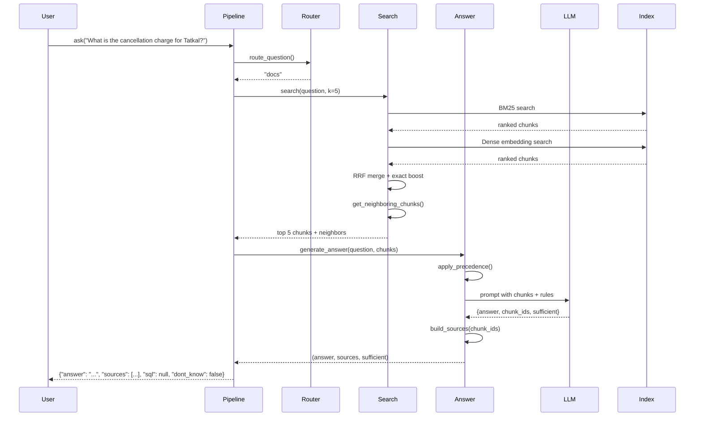
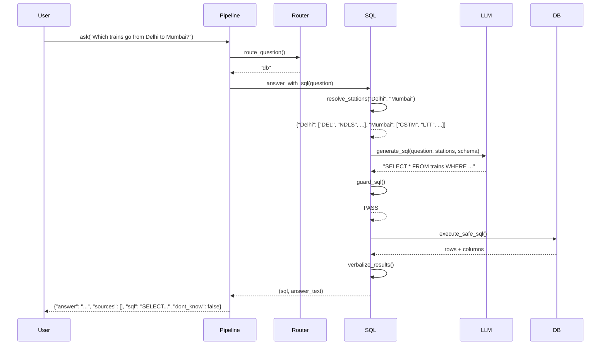
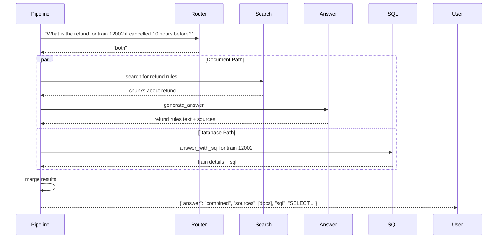

# Design Document
## Railway Passenger Help Desk - GenAI Nexus Capstone

**Version**: 1.0  
**Date**: 2 November 2026  
**Team**: GenAI Nexus, Cohort 1, Module 2

---

## 1. Architecture Overview

### 1.1 System Architecture Diagram

```mermaid
graph TB
    subgraph "User Interface Layer"
        CLI[ask.py CLI]
        Batch[run_questions.py]
        Interactive[Interactive Prompt]
    end

    subgraph "Core Pipeline Layer"
        Pipeline[pipeline.py<br/>ask function]
        Router[Intent Router<br/>docs|db|both|refuse]
    end

    subgraph "Processing Layer"
        DocPath[Document Path]
        DBPath[Database Path]
        
        subgraph "Document Processing"
            Search[search.py<br/>Hybrid Retrieval]
            Answer[answer.py<br/>Grounded Generation]
        end
        
        subgraph "Database Processing"
            SQL[sql.py<br/>Text-to-SQL + Guard]
            Verbalizer[Result Verbalizer]
        end
    end

    subgraph "Supporting Services"
        LLM[llm.py<br/>Gemini Client<br/>Rate Limit + Retry]
    end

    subgraph "Data Layer"
        Index[(index/<br/>Chunks + Embeddings<br/>BM25 Data)]
        DB[(rail_timetable.db<br/>Read-Only SQLite)]
    end

    subgraph "Build Time"
        Ingest[ingest.py<br/>PDF/HTML → Chunks]
        Build[build_index.py]
        DataPack[data/<br/>Documents + DB]
    end

    CLI --> Pipeline
    Batch --> Pipeline
    Interactive --> Pipeline
    
    Pipeline --> Router
    Router --> DocPath
    Router --> DBPath
    
    DocPath --> Search
    Search --> Answer
    Answer --> LLM
    
    DBPath --> SQL
    SQL --> LLM
    SQL --> Verbalizer
    SQL --> DB
    
    Search --> Index
    
    DataPack --> Build
    Build --> Ingest
    Ingest --> Index
    DataPack --> DB
    
    style Pipeline fill:#e1f5ff
    style Router fill:#fff4e1
    style Search fill:#e8f5e9
    style Answer fill:#e8f5e9
    style SQL fill:#f3e5f5
    style LLM fill:#ffebee
    style Index fill:#fce4ec
    style DB fill:#fce4ec
```

### 1.2 Design Principles

1. **Accuracy First**: Every design decision prioritizes correctness over speed or elegance
2. **Graceful Degradation**: Embedding failure falls back to BM25; errors return dont_know instead of crashing
3. **Defense in Depth**: Multiple SQL safety layers (keyword checks, authorizer, query_only, time limits)
4. **Source Traceability**: Every fact flows from chunk metadata, never from LLM hallucination
5. **Fresh Clone Portability**: No hard-coded paths, flexible pack discovery, committed index

---

## 2. Data Model

### 2.1 Chunk Schema

Every document chunk contains:

```python
{
    "chunk_id": str,           # "irctc_refund_2026_p03_c07"
    "doc": str,                # "irctc_refund_rules_jan2026.pdf"
    "page": int | None,        # 3 for PDF, null for HTML
    "date": str,               # "2026-01-19" (ISO format)
    "issuer": str,             # "IRCTC" | "Railway Board" | "PIB Delhi" | "Indian Railways"
    "doc_type": str,           # "pdf_text" | "pdf_scanned" | "html"
    "lang": str,               # "en" | "hi"
    "clause": str | None,      # "7" | "7(a)" | "Rule 25" | null
    "text": str,               # Raw chunk text with header
    "text_for_embedding": str, # Cleaned text for embedding
    "identifiers": {           # Extracted codes for exact matching
        "rules": list[str],         # ["Rule 25"]
        "circulars": list[str],     # ["CC08/2025"]
        "gazettes": list[str],      # ["G.S.R. 41(E)"]
        "trains": list[str],        # ["12002", "11039-Slip"]
        "amounts": list[str]        # ["₹240", "30%"]
    }
}
```

### 2.2 Document Metadata Catalog

Hard-coded in `helpdesk/doc_meta.py`:

```python
DOC_METADATA = {
    "indianrail_refund_rules_2015.html": {
        "issuer": "Indian Railways",
        "date": "2015-11-12",
        "doc_type": "html",
        "scanned_pages": [],
        "lang": "en",
        "notes": "Table with Pre revised and Revised columns"
    },
    "irctc_refund_rules_jan2026.pdf": {
        "issuer": "IRCTC",
        "date": "2026-01-19",
        "doc_type": "pdf_text",
        "scanned_pages": [],
        "lang": "en",
        "tdr_table_pages": [8, 9, 10]
    },
    # ... rest of documents
}
```

### 2.3 Output Contract Schema

```python
{
    "answer": str,                    # Plain language, 2-6 sentences
    "sources": list[{
        "doc": str,                   # Exact filename
        "page": int | None            # 1-indexed PDF page or null
    }],
    "sql": str | None,                # Executed query or null
    "dont_know": bool                 # True when declining
}
```

### 2.4 Database Schema (Live from SQLite)

Read at build time from `sqlite_master`, cached in `index/schema.txt` for SQL prompt:

```sql
-- stations(code TEXT PRIMARY KEY, name TEXT, state TEXT, zone TEXT, 
--          address TEXT, latitude REAL, longitude REAL)
-- train_types(type_code TEXT PRIMARY KEY, meaning TEXT)
-- trains(number TEXT PRIMARY KEY, name TEXT, type_code TEXT, zone TEXT,
--        from_station_code TEXT, to_station_code TEXT, departure TEXT, 
--        arrival TEXT, duration_min INTEGER, distance_km REAL, 
--        return_train TEXT, has_1a INTEGER, has_2a INTEGER, has_3a INTEGER,
--        has_sl INTEGER, has_cc INTEGER, has_fc INTEGER)
-- schedules(train_number TEXT, stop_sequence INTEGER, station_code TEXT,
--           day INTEGER, arrival TEXT, departure TEXT, halt_min INTEGER,
--           is_halt INTEGER, PRIMARY KEY(train_number, stop_sequence))
-- stops (VIEW): SELECT * FROM schedules WHERE is_halt = 1
```

---

## 3. Module Interfaces

### 3.1 `helpdesk/config.py`

Configuration constants and paths.

```python
from pathlib import Path
from dataclasses import dataclass

@dataclass
class Config:
    # Paths
    DATA_DIR: Path = Path("data")
    INDEX_DIR: Path = Path("index")
    
    # Search parameters
    RETRIEVAL_K: int = 5
    BM25_WEIGHT: float = 0.5
    DENSE_WEIGHT: float = 0.5
    EXACT_MATCH_BOOST: float = 2.0
    
    # LLM parameters
    GEMINI_MODEL: str = "gemini-1.5-flash-latest"
    TEMPERATURE: float = 0.0
    TIMEOUT_SECONDS: int = 30
    MAX_RETRIES: int = 3
    
    # SQL safety
    SQL_ROW_LIMIT: int = 50
    SQL_TIMEOUT_MS: int = 5000
    
    # OCR
    OCR_DPI: int = 300
    MIN_TEXT_CHARS: int = 50
    
    # Thresholds
    SUFFICIENCY_THRESHOLD: float = 0.3
    DONT_KNOW_THRESHOLD: float = 0.2
```

### 3.2 `helpdesk/doc_meta.py`

Document metadata only (no answers).

```python
from typing import Dict, List, Optional
from datetime import date

DOC_METADATA: Dict[str, dict] = {
    # As shown in 2.2 above
}

def get_metadata(filename: str) -> Optional[dict]:
    """Get metadata for a document by filename."""
    return DOC_METADATA.get(filename)
```

### 3.3 `helpdesk/ingest.py`

Transform data pack into searchable chunks.

```python
from pathlib import Path
from typing import List, Dict

def ingest_pdf(
    pdf_path: Path,
    metadata: dict
) -> List[Dict]:
    """
    Extract text from PDF page by page.
    Apply OCR when page has < MIN_TEXT_CHARS.
    Return list of chunks with metadata.
    """
    pass

def ingest_html(
    html_path: Path,
    metadata: dict
) -> List[Dict]:
    """
    Parse HTML with BeautifulSoup.
    Special handling for 2015 table and PIB sections.
    Return list of chunks with metadata.
    """
    pass

def chunk_document(
    pages: List[Dict],
    metadata: dict
) -> List[Dict]:
    """
    Split on clause numbers and headings.
    Target 150-400 words, never split clauses or table rows.
    Prepend [doc | page | issuer | date | clause] header.
    Extract identifiers (rules, circulars, trains, amounts).
    """
    pass

def ocr_page(
    image_bytes: bytes,
    lang: str = "en"
) -> str:
    """
    Prefer rapidocr-onnxruntime, fall back to pytesseract.
    Render at OCR_DPI.
    """
    pass
```

### 3.4 `helpdesk/search.py`

Hybrid retrieval with exact-match boosting.

```python
from typing import List, Dict

def search(
    question: str,
    k: int = 5
) -> List[Dict]:
    """
    Hybrid search: BM25 + dense embeddings merged with RRF.
    Exact-match boost for rule numbers, circulars, trains, amounts.
    Return top-k chunks with scores and metadata.
    Falls back to BM25-only if embeddings fail.
    """
    pass

def extract_exact_tokens(question: str) -> Dict[str, List[str]]:
    """
    Regex-extract: Rule N, Circular CC/YY, G.S.R. X(Y), 
    5-digit train numbers, ₹ amounts.
    """
    pass

def reciprocal_rank_fusion(
    bm25_results: List[Dict],
    dense_results: List[Dict],
    k: int = 60
) -> List[Dict]:
    """
    Merge two ranked lists using RRF with k=60.
    """
    pass

def get_neighboring_chunks(chunk_ids: List[str]) -> List[Dict]:
    """
    For each chunk, return prev/next clauses in same document.
    For short docs, return whole document.
    """
    pass
```

### 3.5 `helpdesk/llm.py`

Gemini client with resilience.

```python
from typing import Optional, Dict, Any
import google.generativeai as genai

class GeminiClient:
    def __init__(self, api_key: str, model: str):
        """
        Initialize with key from .env, model from config.
        Set up rate limiter (free tier: ~15 RPM).
        """
        pass
    
    def generate(
        self,
        prompt: str,
        schema: Optional[Dict] = None,
        temperature: float = 0.0,
        timeout: int = 30
    ) -> str:
        """
        Call Gemini with wait-and-retry.
        Exponential backoff + jitter on 429, 500, 503.
        Respect retry_delay hints.
        Use JSON mode when schema provided.
        Cache responses keyed by hash(model, prompt) if enabled.
        Never log the key.
        """
        pass
    
    def embed(self, text: str) -> List[float]:
        """
        Generate embedding using Gemini embedding endpoint.
        Fall back gracefully on error.
        """
        pass
```

### 3.6 `helpdesk/sql.py`

Text-to-SQL with defense in depth.

```python
import sqlite3
from typing import Tuple, Optional, List, Dict

def answer_with_sql(
    question: str,
    llm_client: GeminiClient
) -> Tuple[Optional[str], Optional[List[List]], Optional[List[str]]]:
    """
    Step 1: Resolve station names to codes
    Step 2: Generate SQL with Gemini + schema + quirks + resolved codes
    Step 3: Guard and execute (read-only, time limit, row limit)
    Step 4: Verbalize results
    
    Returns: (sql_string, rows, columns) or (None, None, None) on refusal
    """
    pass

def resolve_stations(question: str) -> Dict[str, List[str]]:
    """
    Find station mentions, match to stations.code via:
    1. Exact code match (case-insensitive)
    2. Exact name match (case-insensitive)
    3. Fuzzy match with rapidfuzz (score > 85)
    
    For multi-station cities, return all codes.
    """
    pass

def generate_sql(
    question: str,
    resolved_stations: Dict[str, List[str]],
    llm_client: GeminiClient,
    schema: str
) -> str:
    """
    Prompt Gemini with:
    - Live schema
    - Quirks (stops view, overnight formula, train.number is TEXT)
    - Resolved station codes
    - Generic example patterns (no answers)
    - Request: one SELECT statement only
    """
    pass

def guard_sql(sql: str) -> bool:
    """
    Return True if safe, False if rejected.
    
    Checks:
    - Strip comments
    - Exactly one statement
    - First keyword SELECT or WITH
    - No: INSERT UPDATE DELETE DROP ALTER CREATE REPLACE 
         ATTACH DETACH PRAGMA VACUUM
    """
    pass

def execute_safe_sql(
    sql: str,
    db_path: Path
) -> Tuple[List[List], List[str]]:
    """
    Open: sqlite3.connect("file:...?mode=ro", uri=True)
    Run: PRAGMA query_only = ON
    Install: set_authorizer (allow SELECT, READ, FUNCTION only)
    Install: set_progress_handler (time limit)
    Wrap: SELECT * FROM (<sql>) LIMIT 50 if no smaller LIMIT
    Execute and return (rows, columns)
    On SQL error, retry once with error message to LLM
    """
    pass

def verbalize_results(
    rows: List[List],
    columns: List[str],
    capped: bool
) -> str:
    """
    Plain-language summary.
    Mention 2016 snapshot.
    Say when empty or capped at row limit.
    """
    pass

def is_write_request(question: str) -> bool:
    """
    Cheap keyword check for: change, update, delete, remove, modify, set
    """
    pass
```

### 3.7 `helpdesk/answer.py`

Grounded generation with source citation.

```python
from typing import Dict, List, Tuple

def generate_answer(
    question: str,
    chunks: List[Dict],
    llm_client: GeminiClient
) -> Tuple[str, List[Dict], bool]:
    """
    Input: question + retrieved chunks with metadata
    Output: (answer_text, source_citations, sufficient_flag)
    
    Prompt rules:
    - Answer only from supplied chunks
    - Quote numbers exactly
    - If two docs conflict, state the later-dated one + mention replacement
    - Train-specific rule overrides general rule
    - "Pre revised" column is history
    - PIB future statements reported as announced, not in force
    - If insufficient, set sufficient=false
    
    Post-process:
    - Extract chunk_ids model says it used
    - Build sources from chunk metadata (doc, page)
    - Deduplicate and order with best first
    - Limit to 2-4 sources
    
    Arithmetic:
    - Parse time-to-departure hours in Python
    - Choose applicable clause
    - Compute percentage in Python
    """
    pass

def apply_precedence(chunks: List[Dict]) -> List[Dict]:
    """
    When multiple chunks on same topic from different docs:
    - Sort by date descending
    - Keep all for model to decide, but mark precedence
    """
    pass

def build_sources(
    chunk_ids: List[str],
    all_chunks: List[Dict]
) -> List[Dict[str, any]]:
    """
    Map chunk_ids to source citations.
    Return [{"doc": filename, "page": int|null}, ...]
    Deduplicate, order by relevance, limit to 2-4.
    """
    pass

def compute_refund_percentage(
    hours_to_departure: float,
    train_type: str,
    chunks: List[Dict]
) -> Tuple[float, str]:
    """
    Parse refund rules from chunks.
    Match hours_to_departure to clause.
    Return (percentage, clause_reference).
    """
    pass
```

### 3.8 `helpdesk/pipeline.py`

Main orchestration and routing.

```python
from typing import Dict

def ask(question: str) -> Dict:
    """
    Main entry point.
    
    Flow:
    1. Route question (docs | db | both | refuse | out_of_scope)
    2. Execute appropriate path(s)
    3. Merge results if both
    4. Return output contract
    5. Never raise; catch all errors -> dont_know
    
    Returns: {"answer": str, "sources": list, "sql": str|None, "dont_know": bool}
    """
    try:
        route = route_question(question)
        
        if route == "refuse" or route == "out_of_scope":
            return refuse(question, route)
        
        if route == "docs":
            return answer_from_docs(question)
        
        if route == "db":
            return answer_from_db(question)
        
        if route == "both":
            return answer_from_both(question)
    
    except Exception as e:
        return {
            "answer": f"Internal error: {str(e)}",
            "sources": [],
            "sql": None,
            "dont_know": True
        }

def route_question(question: str) -> str:
    """
    Classify into: docs | db | both | refuse | out_of_scope
    
    Stage 1: Cheap keyword rules
    - Write verbs (change, update, delete) -> refuse
    - Train number or station -> db
    - "rule", "refund", "Tatkal", "booking limit", "chart" -> docs
    
    Stage 2: Gemini classification with confidence
    - Low confidence -> ask for clarification or default to docs
    """
    pass

def answer_from_docs(question: str) -> Dict:
    """Search + Answer pipeline"""
    pass

def answer_from_db(question: str) -> Dict:
    """SQL + Verbalize pipeline"""
    pass

def answer_from_both(question: str) -> Dict:
    """Run both, merge one answer with both source lists + SQL"""
    pass

def refuse(question: str, reason: str) -> Dict:
    """
    Generate polite refusal.
    Explain what's missing, suggest what pack can answer.
    """
    pass
```

---

## 4. Build Process

### 4.1 `build_index.py`

```python
def main():
    """
    1. Discover data pack under data/ (flexible layout)
    2. Read schema.md and README.md
    3. For each document:
       a. Load metadata from doc_meta.py
       b. Ingest (PDF text/OCR or HTML)
       c. Chunk
    4. Build BM25 index from all chunks
    5. Generate embeddings (local or Gemini)
    6. Write to index/:
       - chunks.json (all chunks with metadata)
       - embeddings.npy (dense vectors)
       - bm25.pkl (BM25 model)
       - schema.txt (live schema from sqlite_master)
       - manifest.json (pack hash, parameters, build timestamp)
    7. Print table: doc | pages | OCR'd pages
    8. Fail loudly if any PDF page has no text
    """
    pass
```

### 4.2 Index Directory Structure

```
index/
├── chunks.json              # All chunks with full metadata
├── embeddings.npy           # Dense embeddings (if using local model)
├── bm25.pkl                 # BM25 model (rank_bm25)
├── schema.txt               # Live SQLite schema for SQL prompt
├── manifest.json            # Build metadata
└── cache/                   # Optional LLM response cache (git-ignored)
```

### 4.3 Manifest Schema

```json
{
  "build_timestamp": "2026-11-02T10:30:00Z",
  "pack_hash": "sha256:abc123...",
  "parameters": {
    "chunk_target_words": 250,
    "ocr_dpi": 300,
    "embedding_model": "BAAI/bge-small-en-v1.5",
    "bm25_k1": 1.5,
    "bm25_b": 0.75
  },
  "statistics": {
    "total_chunks": 247,
    "total_documents": 7,
    "ocr_pages": 8
  }
}
```

---

## 5. Error Handling Strategy

### 5.1 Error Categories and Responses

| Error Type | Detection | Response | Output |
|------------|-----------|----------|--------|
| **Missing .env** | Startup | Print clear message: "Create .env with GEMINI_API_KEY" | Exit code 1 |
| **Missing data/** | Startup | Print: "Unzip rail_capstone_pack.zip into data/" | Exit code 1 |
| **Missing index/** | Startup | Print: "Run: python build_index.py" | Exit code 1 |
| **Invalid API key** | First LLM call | Print: "Check GEMINI_API_KEY in .env" | Exit code 1 |
| **Model not found** | LLM call | Print: "Set GEMINI_MODEL in .env to a valid model" | Exit code 1 |
| **Rate limit (429)** | LLM call | Wait and retry with exp backoff + jitter | Transparent |
| **Embedding failure** | Search | Fall back to BM25 only, log warning | Continue |
| **OCR failure** | Build | Fail loudly, report which page | Exit code 1 |
| **SQL injection attempt** | Guard | Return dont_know with refusal | Safe response |
| **SQL timeout** | Execution | Return dont_know: "Query too complex" | Safe response |
| **Out of scope question** | Router | Polite refusal with explanation | dont_know: true |
| **Insufficient retrieval** | Answer | Set sufficient=false, return dont_know | dont_know: true |
| **Any unexpected error** | ask() top level | Catch, return dont_know with honest message | Never crash |

### 5.2 Logging Strategy

- **DEBUG**: Route decisions, chunk scores, timings, cache hits
- **INFO**: Question received, answer returned, SQL executed
- **WARNING**: Embedding fallback, retry attempts, low confidence
- **ERROR**: Guard violations, OCR failures, API errors
- **CRITICAL**: Missing required files, invalid configuration

Never log API keys or PII.

---

## 6. Test Strategy

### 6.1 Unit Tests (`tests/`)

**test_sql_guard.py**
- Rejects INSERT, UPDATE, DELETE, DROP, ALTER, CREATE, REPLACE, ATTACH, DETACH, PRAGMA, VACUUM
- Rejects multiple statements (semicolon-separated)
- Strips and rejects SQL comments
- Allows SELECT and WITH
- Allows SELECT with subqueries

**test_station_resolution.py**
- Exact code match: "DEL" → ["DEL"]
- Case-insensitive name: "new delhi" → ["NDLS", "DEE", ...]
- Fuzzy match: "Bangalor" → ["SBC", "BNC", ...]
- Multi-station city: "Chennai" → ["MAS", "MS", "MSB", ...]

**test_chunking.py**
- Table rows remain whole
- Column headers repeated in 2015 table chunks
- TDR table rows keep headers
- Clause splitting never breaks a clause
- 150-400 word target maintained (±20%)

**test_sources.py**
- Source page numbers match chunk.page
- Source docs match chunk.doc
- Deduplication works
- Limit to 2-4 sources enforced

**test_contract.py**
- ask() output has all keys: answer, sources, sql, dont_know
- ask() never raises (always returns dict)
- sources items have doc and page keys
- sql is string or None
- dont_know is boolean

**test_entity_extraction.py**
- Extracts "Rule 25" → identifiers.rules
- Extracts "CC08/2025" → identifiers.circulars
- Extracts "12002" → identifiers.trains
- Extracts "₹240" → identifiers.amounts

### 6.2 Integration Tests

**test_ten_samples.py**
- Load `questions/sample_questions.json`
- Run ask() on each
- Compare answer (substring match on key facts)
- Compare sources (set equality on {doc, page})
- Compare sql (execution result equality, not text)
- Compare dont_know flag
- All 10 must pass

### 6.3 Evaluation Suite (`eval/`)

**evaluate.py**
```python
def evaluate(test_set_path: Path, results_path: Path) -> Dict:
    """
    Metrics:
    - Retrieval: Hit@1, Hit@5, MRR (chunk {doc,page} matches gold source)
    - Answer accuracy: Gemini as judge + key-fact regex match
    - Source precision: len(correct sources) / len(returned sources)
    - Source recall: len(correct sources) / len(gold sources)
    - Dont_know correctness: true positives and false positives
    - SQL match: result set equality
    - Latency: mean, p50, p95, p99 per question
    
    Output: JSON report + printed table
    """
    pass
```

**experiments.md tracking table**
```markdown
| Experiment | Hit@5 | MRR | Accuracy | Source F1 | Latency | Notes |
|------------|-------|-----|----------|-----------|---------|-------|
| Baseline BM25 | 0.72 | 0.58 | 0.65 | 0.70 | 3.2s | |
| + Dense | 0.78 | 0.64 | 0.68 | 0.73 | 4.1s | fastembed |
| + RRF | 0.81 | 0.67 | 0.70 | 0.75 | 4.1s | k=60 |
| + Exact boost | 0.85 | 0.72 | 0.75 | 0.78 | 4.2s | 2x weight |
| + OCR | 0.88 | 0.75 | 0.80 | 0.82 | 4.3s | 8 pages |
| + Rerank | 0.89 | 0.77 | 0.81 | 0.83 | 5.8s | cross-encoder |
| + Router | 0.89 | 0.77 | 0.84 | 0.85 | 5.6s | better refusals |
| + Prompt v2 | 0.89 | 0.77 | 0.87 | 0.88 | 5.7s | precedence rules |
```

Keep only changes that improve metrics.

---

## 7. Data Flow Diagrams

### 7.1 Document Question Flow



### 7.2 Timetable Question Flow



### 7.3 Mixed Question Flow



---

## 8. Precedence and Conflict Resolution

### 8.1 Document Date Precedence

When chunks from multiple documents address the same topic:

1. **Sort by date descending** (newer first)
2. **Pass all to LLM** with date metadata
3. **Prompt instructs**: "If documents conflict, state the later-dated rule and mention it replaces the older one"
4. **Verify in code**: Check that answer cites the newer document

Example conflict:
- `indianrail_refund_rules_2015.html` (2015-11-12)
- `irctc_refund_rules_jan2026.pdf` (2026-01-19)

Answer must cite 2026 rules and say they replaced 2015 rules.

### 8.2 Train-Specific Overrides

General refund rules vs. train-specific rules:

1. **Detect train type mentions**: "Vande Bharat Sleeper", "Amrit Bharat II"
2. **Pass both general and specific chunks** to LLM
3. **Prompt instructs**: "Train-specific rule overrides general rule"
4. **Answer cites the specific rule**

Example:
- General: `irctc_refund_rules_jan2026.pdf`
- Specific: `rb_cc08_2026_vande_bharat_sleeper_refund.pdf` (gazette page 5)

### 8.3 Historical vs. Current Data

The 2015 table has "Pre revised" and "Revised" columns:

1. **Chunk each row** with both column labels
2. **Prompt instructs**: "Pre revised column is history, not current"
3. **Answer uses only "Revised" column values**

---

## 9. Security Architecture

### 9.1 SQL Injection Defense Layers

**Layer 1: Keyword Blacklist**
```python
FORBIDDEN = ["INSERT", "UPDATE", "DELETE", "DROP", "ALTER", 
             "CREATE", "REPLACE", "ATTACH", "DETACH", 
             "PRAGMA", "VACUUM"]
```

**Layer 2: Statement Parsing**
- Strip comments (`--`, `/**/`)
- Split on `;` → exactly 1 statement
- First keyword must be `SELECT` or `WITH`

**Layer 3: SQLite Read-Only Mode**
```python
conn = sqlite3.connect("file:path?mode=ro", uri=True)
conn.execute("PRAGMA query_only = ON")
```

**Layer 4: Authorizer**
```python
def authorizer(action, arg1, arg2, db, trigger):
    if action in [sqlite3.SQLITE_SELECT, sqlite3.SQLITE_READ, sqlite3.SQLITE_FUNCTION]:
        return sqlite3.SQLITE_OK
    return sqlite3.SQLITE_DENY

conn.set_authorizer(authorizer)
```

**Layer 5: Progress Handler (Timeout)**
```python
conn.set_progress_handler(lambda: timeout_exceeded, 100)
```

**Layer 6: Row Limit**
```python
if "LIMIT" not in sql.upper():
    sql = f"SELECT * FROM ({sql}) LIMIT {SQL_ROW_LIMIT}"
```

### 9.2 API Key Protection

1. **Storage**: `.env` file only, git-ignored
2. **Loading**: `python-dotenv` at runtime
3. **Never log**: Redact in all log statements
4. **Never print**: No debug prints of credentials
5. **Never commit**: Pre-commit hook checks for patterns

`.gitignore`:
```
.env
.venv/
data/
index/cache/
__pycache__/
*.pyc
```

Pre-commit check:
```bash
# In scripts/pre-commit-check.sh
if git diff --cached | grep -E "(GEMINI_API_KEY\s*=\s*[A-Za-z0-9_-]{20,})"; then
    echo "ERROR: API key found in commit"
    exit 1
fi
```

---

## 10. Performance Considerations

### 10.1 Latency Budget

| Operation | Target | Notes |
|-----------|--------|-------|
| Index loading | <2s | Startup time |
| BM25 search | <100ms | In-memory |
| Embedding search | <200ms | fastembed or Gemini |
| LLM call (answer) | <5s | Gemini Flash |
| LLM call (SQL) | <3s | Smaller prompt |
| SQL execution | <500ms | Row limit + timeout |
| **Total per question** | <10s | User-facing SLA |

### 10.2 Optimization Strategies

**Caching**:
- LLM responses keyed by `hash(model, prompt)` (optional, dev only)
- Embeddings cached in index (built once)
- Schema cached in `index/schema.txt`

**Batch Processing**:
- `run_questions.py` processes sequentially but writes after each (crash-safe)
- Rate limiter prevents 429s

**Index Size**:
- ~250 chunks × 384 dims × 4 bytes ≈ 380 KB embeddings
- BM25 sparse, minimal memory
- Total index < 5 MB, loads fast

**Embedding Model Selection**:
- Local (fastembed): No network, instant, but CPU-bound
- Gemini: Free tier, network latency, rate limited
- **Recommendation**: Start with fastembed, fall back to Gemini on import failure

---

## 11. Deployment Model

### 11.1 Fresh Clone Setup

```bash
# Grader workflow
git clone https://github.com/team-N/genai-nexus-capstone-team-N.git
cd genai-nexus-capstone-team-N

# Setup
python -m venv .venv
source .venv/bin/activate  # Windows: .venv\Scripts\activate
pip install -r requirements.txt

# Configure
cp .env.example .env
# Edit .env: add GEMINI_API_KEY=...

# Unzip data
unzip rail_capstone_pack.zip -d data/

# Build index (one-time, ~2 minutes)
python build_index.py

# Run
python run_questions.py questions/sample_questions.json results.json

# Verify
python eval/evaluate.py results.json
```

### 11.2 File Ownership

| Path | Committed | Generated | Git-Ignored |
|------|-----------|-----------|-------------|
| `helpdesk/*.py` | ✓ | | |
| `index/` | ✓ | ✓ | |
| `index/cache/` | | ✓ | ✓ |
| `data/` | | ✓ | ✓ |
| `.env` | | ✓ | ✓ |
| `.env.example` | ✓ | | |
| `requirements.txt` | ✓ | | |
| `eval/test_set.json` | ✓ | | |
| `eval/experiments.md` | ✓ | | |
| `results.json` | | ✓ | Optional |

---

## 12. Team Collaboration Design

### 12.1 Module Ownership (Example Distribution)

| Team Member | Modules | Tasks |
|-------------|---------|-------|
| **Member A** | `ingest.py`, `build_index.py` | Document parsing, OCR, chunking, build process |
| **Member B** | `search.py`, `llm.py` | Hybrid retrieval, BM25, embeddings, Gemini client |
| **Member C** | `sql.py`, `answer.py` | Text-to-SQL, guards, grounded generation |
| **Member D** | `pipeline.py`, `ask.py`, `run_questions.py` | Routing, CLI, batch runner |
| **All** | `eval/`, tests, README | Evaluation, test set, experiments, docs |

### 12.2 Git Workflow

1. **Main branch**: Protected, requires PR
2. **Feature branches**: `feature/member-A-ingest`, `feature/member-B-search`
3. **Daily merges**: Integrate at EOD to avoid big bang
4. **Pair review**: Each PR reviewed by at least one other member
5. **Commit messages**: `[Module] Brief description` (e.g., `[ingest] Add OCR fallback`)

### 12.3 Communication Protocol

- **Daily standup** (10 min): What I did, what I'm doing, blockers
- **Slack channel**: Quick questions, build status
- **Shared doc**: Decision log (why we chose fastembed over Gemini embeddings, etc.)
- **Demo prep** (Thu PM): Everyone practices explaining their code

---

## 13. Known Limitations and Mitigations

| Limitation | Impact | Mitigation |
|------------|--------|------------|
| **2016 timetable** | No recent trains (Vande Bharat) | Answer mentions 2016 snapshot |
| **Free tier rate limits** | Slow on large batches | Rate limiter + retry with backoff |
| **No live data** | Can't answer PNR status, seat availability | Router refuses politely |
| **OCR accuracy** | Hindi pages may have errors | Rank English pages higher; test on scanned English |
| **Small pack** | Limited refund rules coverage | Clear "I don't know" when answer not in pack |
| **LLM cost** | Free tier quota exhaustion | Cache responses in dev; use Flash model |
| **Fuzzy station names** | "Bombay" vs "Mumbai" | Fuzzy match with rapidfuzz |

---

## 14. Acceptance Criteria Traceability

| Requirement ID | Design Component | Verification |
|----------------|------------------|--------------|
| FR-1.1 | `pipeline.ask()` returns dict | `test_contract.py` |
| FR-1.2 | try/except wrapper in `ask()` | `test_contract.py` |
| FR-2.1 | `ingest.ocr_page()` threshold | `build_index.py` output table |
| FR-2.4 | `ingest.chunk_document()` | `test_chunking.py` |
| FR-3.1 | `sql.execute_safe_sql()` | `test_sql_guard.py` |
| FR-4.1 | `search.search()` RRF merge | `eval/evaluate.py` Hit@5 |
| FR-5.1 | `answer.generate_answer()` prompt | Manual review + eval accuracy |
| FR-5.6 | `answer.build_sources()` | `test_sources.py` |
| FR-8.1 | `build_index.py` main() | Manual run + idempotence test |
| NFR-1.1 | `.env` loading, no logs | Code review + git log check |
| NFR-2.3 | `scripts/fresh_clone_test.sh` | CI/CD run |

---

## 15. Open Design Questions (To Resolve in Tasks)

1. **Embedding model choice**: fastembed (offline, fast) vs. Gemini (online, rate limited)?
   - **Decision**: Start with fastembed, fall back to Gemini on import error
   
2. **Query rewriting**: Does it improve Hit@5 enough to justify the extra LLM call?
   - **Decision**: Implement behind a flag, test in experiments.md, keep only if +5% Hit@5
   
3. **Cross-encoder reranking**: Worth the latency?
   - **Decision**: Same as query rewriting, test and keep if metrics improve
   
4. **Router implementation**: Rule-based vs. LLM-based?
   - **Decision**: Hybrid: cheap rules first, LLM for unclear cases
   
5. **SQL retry strategy**: One retry with error message or zero tolerance?
   - **Decision**: One retry passing error back to LLM, then give up

6. **Hindi page handling**: Index with low weight or skip entirely?
   - **Decision**: Index with `lang: "hi"`, rank below English in RRF, useful for completeness

---

## Appendix A: Technology Stack

| Layer | Technology | Version | Justification |
|-------|-----------|---------|---------------|
| **Language** | Python | 3.10+ | Capstone requirement, wide library support |
| **LLM** | Gemini | Flash (latest) | Free tier, fast, JSON mode |
| **PDF** | PyMuPDF | Latest | Fast, reliable text extraction |
| **OCR** | rapidocr-onnxruntime | Latest | No system dependencies, pip-only |
| **OCR Fallback** | pytesseract | Latest | Widely available |
| **HTML** | BeautifulSoup4 | Latest | Standard for HTML parsing |
| **BM25** | rank_bm25 | Latest | Simple, effective keyword search |
| **Embeddings** | fastembed | Latest | Local, CPU-only, no GPU needed |
| **Fuzzy Match** | rapidfuzz | Latest | Fast Levenshtein distance |
| **DB** | sqlite3 | stdlib | No install, read-only mode |
| **Env** | python-dotenv | Latest | Standard for .env files |
| **Testing** | pytest | Latest | Standard Python test framework |
| **CLI** | argparse | stdlib | Sufficient for simple CLI |
| **Optional** | rich | Latest | Nice terminal formatting |

---

## Appendix B: Prompt Templates (Sketches)

### B.1 SQL Generation Prompt

```
You are a SQLite expert. Generate one SELECT query for this question.

Schema:
{schema}

Rules:
- Use the `stops` view (not schedules) for "trains from A to B"
- train.number is TEXT, keep leading zeros
- Overnight: travel_min = (day_b - day_a) * 1440 + minutes(arrival_b) - minutes(departure_a)
- Times are HH:MM strings

Resolved stations:
{resolved_stations}

Question: {question}

Return JSON: {"sql": "SELECT ..."}
```

### B.2 Answer Generation Prompt

```
You are a railway helpdesk assistant. Answer this question using ONLY the provided chunks.

Rules:
1. Quote numbers, dates, and amounts exactly
2. If two documents conflict, use the later-dated document and say it replaced the older one
3. If a train-specific rule exists, it overrides the general rule
4. The "Pre revised" column in the 2015 table is history; use "Revised"
5. PIB statements phrased as future ("soon") should be reported as announced, not in force
6. If the chunks don't contain the answer, say so clearly

Chunks:
{chunks}

Question: {question}

Return JSON:
{
  "answer": "plain text, 2-6 sentences",
  "chunk_ids_used": ["id1", "id2"],
  "sufficient": true/false
}
```

### B.3 Router Prompt

```
Classify this question into one category:

- "docs": refund rules, booking limits, Tatkal, charts, cancellation charges
- "db": train schedules, station lists, departure/arrival times, stops
- "both": mixed (e.g., "refund for train 12002")
- "out_of_scope": fares, seat availability, waitlist confirmation, PNR status, live running
- "refuse": requests to change data

Question: {question}

Return JSON: {"route": "docs|db|both|out_of_scope|refuse", "confidence": 0.0-1.0}
```

---

**End of Design Document**
